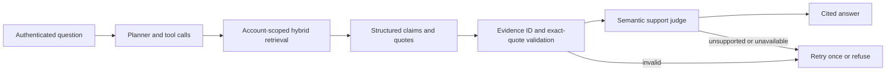

# StackLens

**StackLens is a document-based engineering knowledge assistant.**

It lets a user upload technical documents—such as API contracts, architecture notes, and
operational runbooks—and ask questions about them through a web interface, HTTP API, or CLI.
The assistant searches the uploaded documents before answering, returns source information with
its response, and refuses when the available evidence does not support an answer.

> StackLens includes local and GitHub pull-request review workflows. GitHub publishing is
> opt-in: review results are printed without changing a pull request unless `--publish` is used.

## Why this project exists

General-purpose chatbots can produce confident answers that are not present in a team's
documentation. StackLens is designed around a narrower workflow:

1. A user uploads private engineering documents.
2. The system splits and indexes the documents.
3. A question is sent to the assistant.
4. The agent searches the user's document collection.
5. The generated claims are checked against the retrieved passages.
6. The system returns a cited answer or a refusal.

## Example

Upload the sample documents in [`data/`](data/) and ask:

> What happens if an idempotency key is reused with a different body?

StackLens searches the sample API and architecture documents, then answers using the matching
passages. The sample documents describe a fictional Atlas service; they are demonstration data,
not production policies.

## What is implemented

### AI and retrieval

- OpenAI chat and embedding model integration.
- Retrieval-augmented generation (RAG).
- Hybrid search combining pgvector similarity search with PostgreSQL full-text search.
- LangChain tools and an explicit LangGraph workflow.
- Documentation search and restricted arithmetic calculator tools.
- Structured Pydantic answer schemas.
- Evidence IDs and exact-quote validation.
- Optional semantic support judging, bounded retries, and refusal of unsupported answers.

### Backend and reliability

- FastAPI web/API layer and a CLI.
- Account-scoped document collections and cookie sessions.
- Upload validation and safe upload-path checks.
- PostgreSQL/pgvector for document chunks and embeddings.
- Redis-backed sessions and rate-limit storage, with documented local fallbacks.
- SQLite application storage for users, sessions, and ingestion jobs.
- Optional Kafka ingestion with job leases, duplicate handling, and failed-job retries.
- Request, token, latency, and estimated-cost metrics.
- Optional Langfuse tracing.
- GitHub pull-request review through the REST API, with dry-run output by default and explicit
  opt-in inline comment publishing.
- Sensitive-file filtering, secret redaction, changed-line validation, and explicit partial-review
  reporting protect the review prompt and published output.

### Evaluation

The evaluation package measures retrieval hits, citation correctness, factual coverage, refusal
behavior, groundedness, latency, token usage, and estimated cost. The included dataset is small
and synthetic; it is not an accuracy benchmark for production use.

### Local diff review

The local review MVP accepts a unified diff and a repository directory. It asks the model to
identify actionable correctness or security issues using the diff and current file contents, then
validates that every finding points to a changed line.

```sh
stacklens review-diff changes.patch --repo-root .
```

### GitHub pull-request review

The GitHub workflow fetches a pull request's changed files and head revision through the GitHub
API, loads the changed file contents at that revision, and runs the same evidence-bound review
pipeline. Sensitive files, secret-like values, binary files, oversized files, and files without
text patches are excluded and reported. Findings are printed locally by default. Use `--publish`
only after reviewing the output; it creates a pull-request review with inline comments on changed
lines. Deletion-only files are reported but have no fabricated comment location.

Set a fine-grained GitHub token privately in `.env`:

```sh
GITHUB_TOKEN=ghp_your_token
```

Then run:

```sh
stacklens review-pr owner/repository 123
stacklens review-pr owner/repository 123 --publish
```

The token is sent only to the configured GitHub API host. Dry-run reviews require pull-request
read access; publishing additionally requires pull-request write access. The integration
does not merge pull requests, push commits, or publish comments unless `--publish` is explicitly
provided. GitHub-hosted file contents and pull-request diffs are treated as untrusted evidence.

For repository automation, [`.github/workflows/review.yml`](.github/workflows/review.yml) provides a
manual workflow. It requires an `OPENAI_API_KEY` repository secret, defaults to dry-run, and
requires the workflow's `publish` input to be set to `true` before posting comments.

This is a portfolio-scale implementation, not a claim of production operation or benchmark
performance. Before public release, review project provenance and third-party notices and document
any components derived from external work. Dependencies retain their own licenses.

## Quick start

Requirements: Docker with Compose and an OpenAI API account with model access and credits.
If `.env` already exists, edit it rather than overwriting it.

```sh
cp .env.example .env  # only for a fresh checkout without .env
# Set OPENAI_API_KEY privately in .env.
docker compose up --build -d
```

Open **http://localhost:8080**, create an account, upload one or more files from `data/`, and wait
for processing to finish. Then ask a question about the uploaded documents.

The OpenAI API key is read by the server and is excluded from Git, the Docker build context, and
the release archive. Never place a real key in source code or commit it to the repository.

The default API binds only to localhost. Cookie sessions identify each user; legacy `/ask`, `/chat`,
`/status`, `/health`, `/ready` and `/feedback` routes require a configured administrator `X-API-Key`.
The public process liveness endpoint is `/api/v1/health`. Liveness does not prove database or model readiness.

### Kafka mode

```sh
docker compose -f docker-compose.yml -f docker-compose.kafka.yml up --build -d
```

Uploads create persistent jobs. The worker publishes job IDs to Kafka and consumes them, deriving
ownership and file paths from the server database. It acknowledges offsets after handling a job.
Duplicate deliveries are safe through atomic claims and deterministic chunk IDs. Failed jobs appear
in the interface with a Retry button. A crashed worker's lease expires after 15 minutes.

The SQLite job/account database and upload volume are shared on **one host**. This setup is not
intended for multi-host replicas. Kafka has one broker and no high-availability guarantee.
Local background ingestion is simpler, but a process crash can leave a job pending; use Kafka for
restart recovery. Public deployment needs HTTPS, secure cookies, restricted registration and backups.

## Answer pipeline



Exact quotes establish provenance, not truth. The model judge can still make mistakes. Retrieved
text is treated as untrusted data and is not allowed to redefine the assistant's instructions.
Users should still check the source documents before acting on an answer.

Optional classifier-based scanning and reranking require `pip install '.[safety]'` and explicit
configuration; they are disabled by default.

## Local development

```sh
python3.12 -m venv .venv
source .venv/bin/activate
pip install -e '.[dev]'
docker compose up -d postgres redis
alembic upgrade head
stacklens serve
```

The browser and CLI use separate collections: browser documents belong to the signed-in account;
`stacklens ingest` indexes `data/` into the default demo collection. Never point the CLI's
`COLLECTION_NAME` at another user's collection.

```sh
stacklens ingest
stacklens ask "How long is an idempotency key retained?"
stacklens eval --dataset evals/dataset.json --limit 20 --max-cost 1 --min-score 0.8
ruff check src tests
ruff format --check src tests
mypy
pytest tests/unit
pytest tests/integration -n 0
```

Integration tests need the pgvector database and migrations. Evaluation needs live model access;
its cost threshold is an estimated post-response check, not a hard provider spending cap.
See the [evaluation notes](evals/README.md) and [project evidence](docs/resume-evidence.md).

## Deployment status and project evidence

[Manual AWS deployment](docs/aws-deployment.md) describes a single-host EC2 setup. No AWS resources
have been created, and no deployment is claimed. CI and container publishing workflows are provided;
they have not run in this repository yet. See [project evidence](docs/resume-evidence.md) for
which claims are supported by the current implementation and which require additional verification.

## Operational limits

- Passwords use PBKDF2; this demo does not include password reset, MFA or email verification.
- Conversation turns are serialized inside one API process. Keep `API_WORKERS=1` for this version.
- Uploads allow text-based PDF, Markdown, text and reStructuredText up to 5 MB. OCR is not included.
- The UI lists the latest 100 ingestion jobs per account. Documents can be deleted through the
  authenticated `DELETE /api/v1/documents/{job_id}` endpoint; deletion is ownership-checked,
  idempotent, removes indexed chunks, and tombstones pending jobs.
- Conversation history is bounded to recent turns and a configurable character budget
  (`MAX_CONVERSATION_TURNS` and `MAX_CONVERSATION_CHARS`).
- Redis failure falls back to process memory; that loses persistence and shared counters until restart.
- Langfuse is opt-in: traces can contain questions and source text. Enable it only for data you intend to send.
- The sample evaluation is small and synthetic. No accuracy, user-count, throughput or latency improvement is claimed.

## Project status

The local development path and unit-test suite are the primary verified workflows. Integration
tests require PostgreSQL/pgvector and migrations. Live evaluation requires model access and may
incur provider costs. AWS deployment, production scale, and model-accuracy improvements are not
claimed unless separately measured and documented.

## Licensing

Review the project provenance and add the appropriate project license and third-party notices
before publishing. Do not remove notices required by source repositories or dependencies.
